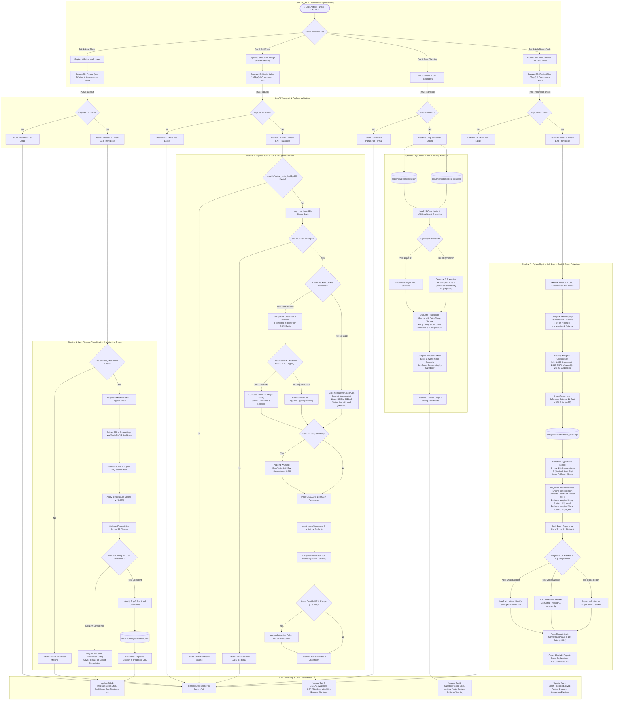

# EdaphNet v2: System Architecture and Technical Workflow Specification

**Document Version:** 2.0  
**Target System:** EdaphNet Cyber-Physical Quality Assurance & Agritech Intelligence Platform  
**Target Deliverables:** Academic Project Report, Technical Documentation, Software Design Review  
**Date:** October 2026  
**Authors:** Senior Software Architect & Technical Documentation Engineer  

---

## 1. Executive Technical Summary

The **EdaphNet v2** platform is a cyber-physical software ecosystem engineered to solve two high-impact agronomic challenges:
1. **Cyber-Physical Analytical Quality Assurance (Research Core):** Mitigating silent failure modes in automated wet-chemistry soil testing laboratories—specifically **physical specimen swaps** (pipetting offsets, rack inversions) and **clerical/analytical value corruptions** (decimal slips, unit confusions, transposed digits, column swaps, gross scaling errors). EdaphNet pairs an independent, non-contact optical witness (ambient smartphone photograph or laboratory diffuse reflectance spectrometer) with an exact Bayesian Maximum A Posteriori (MAP) joint permutation-corruption graphical model and distribution-free split-conformal calibration bounds.
2. **Farmer Field Intelligence (Deployment Layer):** Delivering real-time, low-resource decision support to smallholder farmers through mobile-friendly disease triage (MobileNetV3 transfer learning), optical soil carbon estimation (LightGBM regressors with color constancy), and multi-soil agronomic crop suitability planning (FAO EcoCrop rule engine).

The platform is designed to operate on bounded CPU hardware without mandatory external database servers or cloud dependencies, prioritizing operational accessibility in remote rural contexts and complete experimental reproducibility.

---

## 2. System Architecture Layer Breakdown

The system is organized into nine logical architectural tiers:

```
┌────────────────────────────────────────────────────────────────────────────────────────┐
│                                EDAPHNET v2 ARCHITECTURE                                │
├────────────────────────────────────────────────────────────────────────────────────────┤
│ 1. User & Client Layer         │ Field Farmers, Laboratory QA Techs, Researchers      │
├────────────────────────────────┼───────────────────────────────────────────────────────┤
│ 2. Frontend / Presentation     │ Web SPA (HTML5/Canvas), Streamlit Cloud, Demo Portal  │
├────────────────────────────────┼───────────────────────────────────────────────────────┤
│ 3. API & Communication         │ HTTP REST (Port 8001), Streamlit WebSockets (Port 8501)│
├────────────────────────────────┼───────────────────────────────────────────────────────┤
│ 4. Backend & Business Logic    │ Request Decoders, Lazy Loaders, FAO EcoCrop Advisor   │
├────────────────────────────────┼───────────────────────────────────────────────────────┤
│ 5. Authentication & Access     │ Unauthenticated Open Access (Field / Lab Operations)  │
├────────────────────────────────┼───────────────────────────────────────────────────────┤
│ 6. AI / ML & Processing        │ MobileNetV3, LightGBM Brain, Bayesian Permutation QA │
├────────────────────────────────┼───────────────────────────────────────────────────────┤
│ 7. Storage & Data Persistence  │ Serialized Weights (.joblib), NumPy Archives (.npz)   │
├────────────────────────────────┼───────────────────────────────────────────────────────┤
│ 8. External Integrations       │ PyTorch Torchvision Zoo, OSSL Cloud, Extension Labs   │
├────────────────────────────────┼───────────────────────────────────────────────────────┤
│ 9. Infrastructure & Deployment │ Windows/Linux CPU Host, Docker (Python 3.11-slim)     │
└────────────────────────────────┴───────────────────────────────────────────────────────┘
```

### Layer 1: User & Client Layer
- **Smallholder Farmer:** Interacts using commodity Android/iOS mobile browsers via cellular or local Wi-Fi. Captures leaf disease symptoms and soil field photographs under ambient illumination.
- **Analytical Laboratory QA Technician:** Interacts via laboratory workstations. Uploads LIMS-generated batch report spreadsheets alongside digital optical witness trays to audit consistency before report dissemination.
- **Academic Evaluator & Researcher:** Accesses the Streamlit intelligence dashboard and offline HTML portals to evaluate pre-registered statistical benchmarks, confusion matrices, and ROC/AUPRC curves.

### Layer 2: Frontend & Presentation Layer
- **Farmer Field Assistant Web SPA (`app/web/index.html`):**
  - **Technology:** Vanilla HTML5, CSS3 with native light/dark modes, and ES6 JavaScript.
  - **Design Pattern:** Single-Page Application (SPA) with tabbed navigation: *Leaf Disease Scanner*, *Soil Photo Estimator*, *Crop Suitability Advisor*, and *Lab Report Audit*.
  - **Edge Processing:** Implements client-side Canvas 2D image downsampling (`shrink()` function). Images are clamped to a maximum 1024px dimension and converted to 90% quality JPEG before transport, reducing raw phone payloads (3–12 MB) down to <300 KB.
- **Streamlit Intelligence Dashboard (`streamlit_app.py`):**
  - **Technology:** Streamlit 1.30+ framework running atop Python.
  - **Functionality:** Provides an interactive multi-column visual dashboard integrating camera input widgets, real-time probability distribution gauges, batch consistency scatter plots, and audit status badges.
- **Research Presentation Portal (`demo_site/live.html` & `demo_site/index.html`):**
  - **Functionality:** Supports offline academic viva demonstrations with simulated real-soil spectra, interactive 24-patch color constancy widgets, and step-by-step Bayesian posterior breakdowns.

### Layer 3: API & Communication Layer
- **Core HTTP Application Server (`app/server.py`):**
  - **Technology:** Python Standard Library `http.server.ThreadingHTTPServer`. Default binding: `http://127.0.0.1:8001` (configurable to `0.0.0.0` for local subnet mobile access).
  - **Payload Governance:** Enforces a strict 12 MB request body limit (`MAX_BODY = 12 * 1024 * 1024`) with `413 Payload Too Large` rejection.
  - **REST Endpoints:**
    - `GET /api/status`: Returns system readiness, model file availability, and catalogue sizes.
    - `POST /api/leaf`: Ingests Base64 leaf image; returns disease classification, calibrated confidence, and treatment guidelines.
    - `POST /api/soil`: Ingests Base64 soil image and optional ROI bounding box; returns calibrated CIELAB color and predicted OC, N, and $C_{\text{tot}}$ intervals.
    - `POST /api/crops`: Ingests climate and soil parameters; returns ranked crop suitability scores and limiting factors.
    - `POST /api/report-check`: Ingests soil photo + lab test values; executes Bayesian batch verification against reference soils.
- **Streamlit Communication Runtime:**
  - **Technology:** Tornado WebSocket server operating on port `8501`. Enables reactive UI re-rendering upon widget parameter adjustments.

### Layer 4: Backend & Business Logic Layer
- **Image Preprocessor & Validator (`app/server.py`):**
  - Decodes Base64 data URLs, detects image encoding headers, and leverages Pillow's `ImageOps.exif_transpose` to normalize orientation tags from smartphone cameras.
- **Thread-Safe Lazy Model Manager (`Lazy` Class):**
  - Implements thread-locked on-demand loading (`threading.Lock()`). Models are initialized upon first API invocation rather than server startup, caching import exceptions to prevent daemon crashes.
- **Crop Suitability Advisor (`app/crop/suitability.py`):**
  - Implements agronomic scoring using Liebig's Law of the Minimum: crop suitability equals the minimum performance across individual ecological dimensions ($S_{\text{crop}} = \min(S_{\text{pH}}, S_{\text{rain}}, S_{\text{temp}}, S_{\text{texture}})$).
  - Handles soil uncertainty through multi-scenario weighting (`ph_range_scenarios`).
- **Interactive Batch Synthesizer (`scripts/serve_demo.py`):**
  - Implements `Engine.analyze()`, integrating raw soil images into 12-sample test batches using location-disjoint reference profiles.

### Layer 5: Authentication & Authorization Layer
- **Current State:** **Unauthenticated / Open Access**.
- **Rationale:** Designed as an open academic proof-of-concept and a zero-friction utility for smallholder farmers operating in low-connectivity rural settings. No credentials, tokens, or session cookies are required or persisted.
- **Production Recommendation:** For enterprise laboratory integration, an OAuth2 / JWT bearer token proxy layer (e.g., FastAPI with Nginx) should guard `/api/report-check` and batch ingestion endpoints.

### Layer 6: AI / ML & Scientific Processing Layer
- **Physical Optical Witness & Colorimetry Engine (`src/edaphnet2/phone.py`):**
  - Implements 24-patch ColorChecker chart corner detection and bilinear patch centroid interpolation (`grid_centers`).
  - Estimates illuminant distortion via root-polynomial degree-2 color correction matrices (`fit_ccm`, adapting Finlayson et al. 2015):
    $$\mathbf{f}_{\text{rootpoly}}(R, G, B) = [R, G, B, \sqrt{RG}, \sqrt{GB}, \sqrt{RB}]^T$$
  - Measures residual calibration error using Euclidean color difference $\Delta E_{00}$ (`delta_e00`).
  - Evaluates image quality metrics: Laplacian variance for focus/blur detection (`laplacian_var`) and sensor clipping fractions.
- **Leaf Disease Classification Engine (`app/leaf/model.py`):**
  - **Backbone:** PyTorch TorchVision `mobilenet_v3_large(weights=MobileNet_V3_Large_Weights.IMAGENET1K_V2)`. Extracts 960-dimensional dense feature vectors.
  - **Classifier Head:** Scikit-Learn pipeline (`StandardScaler` + `LogisticRegression(C=0.1, class_weight="balanced")`).
  - **Uncertainty Calibration:** Post-hoc Platt/Temperature scaling ($T = 0.797$) minimizing Negative Log-Likelihood (NLL) on validation logits:
    $$P(y = k \mid \mathbf{x}) = \frac{\exp(z_k / T)}{\sum_j \exp(z_j / T)}$$
  - **Selective Abstention Gate:** If $\max_k P(y=k \mid \mathbf{x}) < 0.50$, the model outputs `"not sure"`, preventing silent hallucinations on out-of-distribution flora.
- **Soil Property Witness Regressors (`scripts/train_colour_brain.py` & `scripts/fit_witness_ladder.py`):**
  - Independent LightGBM multi-output regressors (`lightgbm.LGBMRegressor`) mapping CIELAB $(L^*, a^*, b^*)$ or Vis-NIR SVD/PCA-30 components to latent target space $\mathbf{Z}$.
  - Features data augmentation with isotropic Gaussian noise $(\text{mean } |\Delta E_{76}| = 2.0)$ to replicate smartphone sensor variability.
- **Cyber-Physical Bayesian Inference Engine (`src/edaphnet2/inference.py`):**
  - Solves the exact joint posterior over permutations $\pi \in \mathcal{S}_{\text{tray}}$ and corruptions $c \in \mathcal{C}$ across batches of $n=24$ reports:
    $$\ell(j, i) = \log \sum_{c \in \mathcal{C}_j} P(c) \cdot p\left(T_c^{-1}(r_j) \mid w_i\right) \cdot \left|J_c\right|$$
    $$\log P(\pi \mid \mathbf{R}, \mathbf{w}) = \log P(\pi) + \sum_{j \in \text{moved}(\pi)} \left[\ell(j, \pi(j)) - \ell(j, j)\right] + \text{const}$$
  - **Permutation Group $\mathcal{S}_{\text{tray}}$ (`src/edaphnet2/swaps.py`):** Structured hypothesis set of 281 physically plausible failure modes:
    - $S_0$: Identity (no swap, 1 hypothesis)
    - $S_1$: Adjacent vial inversions $(j, j+1)$ ($n-1 = 23$ hypotheses)
    - $S_2$: Cyclic tray block shifts $\pm 1, \pm 2$ (4 hypotheses)
    - $S_3$: Non-adjacent pairwise transpositions ($\binom{n}{2} - 23 = 253$ hypotheses)
  - **Corruption Library $\mathcal{C}$ (`src/edaphnet2/operators.py`):** Typed inverse operators: decimal shifts ($\times 10, \div 10$), unit confusions (% $\leftrightarrow$ g/kg, ppm $\leftrightarrow$ kg/ha), adjacent-digit transpositions ($0.16 \leftrightarrow 0.61$), column swaps, and gross multiplicative deviations.
- **Distribution-Free Conformal Calibration & FDR Gate (`src/edaphnet2/conformal.py`):**
  - Computes finite-sample conformal p-values against de-duplicated calibration nulls:
    $$p_j = \frac{1 + \sum_{i=1}^{N_{\text{cal}}} \mathbf{1}\{s_i^{\text{cal}} \ge s_j\}}{N_{\text{cal}} + 1}$$
  - Enforces Benjamini-Hochberg (BH) step-up multiple testing at target level $q=0.10$ to ensure rigorous false discovery rate control.
  - Implements density-ratio covariate shift weights (`density_ratio_weights`) via logistic regression for non-exchangeable soil distributions.

### Layer 7: Database & Storage Layer (File-Based & In-Memory)
- **Model Storage (`models/`):**
  - `leaf_head.joblib` (183.8 KB): Serialized Scikit-Learn pipeline + calibrated temperature parameter.
  - `colour_brain_kssl3.joblib` (1.32 MB): Serialized LightGBM models for KSSL soil properties (OC, N, $C_{\text{tot}}$).
  - `colour_brain_icraf8.joblib` (3.47 MB): Serialized LightGBM models for ICRAF-ISRIC properties (8 analytes).
- **Processed Scientific Datasets (`data/processed/`):**
  - `t1_kssl3.npz` (18.4 MB) & `t1_icraf8.npz` (3.3 MB): Pre-screened, location-disjoint train/calibration/test splits.
  - `witness_kssl3.npz` (10.0 MB) & `witness_icraf8.npz` (2.6 MB): Out-of-fold witness predictions and residual covariance matrices $\mathbf{S}$.
- **Agronomic Knowledge Repositories (`app/knowledge/`):**
  - `crops.json`: Traceable ecological limits for 25 crops derived from the FAO EcoCrop database.
  - `crops_local.json`: Sourced local agronomic overrides (enforcing mandatory citation metadata).
  - `diseases.json`: Actionable management guidelines and extension URLs for 26 crop disease classes.
  - `class_map.json`: Cross-dataset taxonomic alignment mapping PlantDoc classes to PlantVillage targets.

### Layer 8: External Services & Third-Party Integrations
- **PyTorch / TorchVision Model Zoo:** External CDN providing pretrained weights for MobileNetV3-Large (`IMAGENET1K_V2`), retrieved once during initial installation.
- **Google Cloud Storage (`soilspec4gg-public`):** Upstream scientific repository hosting the raw Open Soil Spectral Library (OSSL v1.2) archives.
- **Human-in-the-Loop Escalation:** Protocol routing suspicious laboratory batches or low-confidence leaf disease predictions to certified extension officers or agricultural diagnostic laboratories.

### Layer 9: Deployment & Infrastructure Layer
- **Local Host Execution:** Native execution on Windows 11 / Linux with Python 3.13 / 3.14. Utilizes lightweight single-process standard library HTTP daemons requiring <1 GB RAM.
- **Cloud & Container Deployment:**
  - `Dockerfile`: Portable Debian-based Python 3.11-slim container installing headless dependencies (`pillow`, `torch`, `torchvision`, `lightgbm`).
  - `render.yaml` & `Procfile`: Ready-to-deploy configuration for Platform-as-a-Service (PaaS) web hosting.
  - Streamlit Community Cloud: Zero-configuration deployment via `streamlit_app.py`.

---

## 3. System Architecture Diagram

The system architecture diagram is saved in the repository at [`docs/system_architecture.mmd`](file:///h:/Projects/edaphnet-v2-main/edaphnet-v2-main/docs/system_architecture.mmd). 
A high-resolution vector rendering is provided at [`docs/system_architecture.svg`](file:///h:/Projects/edaphnet-v2-main/edaphnet-v2-main/docs/system_architecture.svg) and a publication-grade bitmap rendering is available at [`docs/system_architecture.png`](file:///h:/Projects/edaphnet-v2-main/edaphnet-v2-main/docs/system_architecture.png).

```mermaid
flowchart TB
    subgraph Client_Layer["1. User & Client Layer"]
        direction LR
        Farmer["👨‍🌾 Smallholder Farmer<br/>(Field Mobile Camera / Web Browser)"]
        LabTech["🔬 Analytical Lab Technician<br/>(LIMS Batch Data Entry / QA Review)"]
        Researcher["🎓 Researcher & Student Evaluator<br/>(Benchmark Evaluation & Viva Presentation)"]
    end

    subgraph Presentation_Layer["2. Frontend & Presentation Layer"]
        direction TB
        subgraph Web_UI["Farmer Field Assistant Web SPA (app/web/index.html)"]
            direction LR
            SPA_Leaf["Tab 1: Leaf Scanner<br/>(Camera / Upload Picker)"]
            SPA_Soil["Tab 2: Soil Estimator<br/>(Central ROI Box)"]
            SPA_Crop["Tab 3: Crop Advisor<br/>(pH, Climate, Texture)"]
            SPA_Report["Tab 4: Lab Audit<br/>(Photo + Lab Form)"]
            Canvas_Downsampler["Canvas 2D Downsampler<br/>(Max 1024px JPEG Compression)"]
        end
        Streamlit_Dash["Streamlit Intelligence Dashboard<br/>(streamlit_app.py)<br/>Unified 4-Module Web App"]
        Demo_Site["Research Demo Portal<br/>(demo_site/live.html & index.html)<br/>Interactive Batch Visualizer"]
    end

    subgraph API_Layer["3. API & Communication Layer (HTTP / JSON / WebSockets)"]
        direction TB
        Server["Multi-Threaded HTTP Server (app/server.py)<br/>Python ThreadingHTTPServer (Port 8001)"]
        subgraph Endpoints["REST API Endpoints"]
            EP_Status["GET /api/status<br/>Health & Catalogue Check"]
            EP_Leaf["POST /api/leaf<br/>Base64 Image Payload (Max 12MB)"]
            EP_Soil["POST /api/soil<br/>Base64 Image + ROI Corners"]
            EP_Crops["POST /api/crops<br/>pH, Rain, Temp, Texture JSON"]
            EP_Report["POST /api/report-check<br/>Soil Photo + Lab Report JSON"]
        end
        Streamlit_RPC["Streamlit WebSocket Engine<br/>Tornado Runtime (Port 8501)"]
    end

    subgraph Backend_Layer["4. Backend & Business Logic Layer"]
        direction TB
        Decoder["Image Decoder & Validator<br/>Base64 Decode & Pillow EXIF Normalizer"]
        Lazy_Mgr["Thread-Safe Lazy Model Loader<br/>(Lazy Loader with Error Caching)"]
        Crop_Engine["Crop Suitability Engine (app/crop/suitability.py)<br/>Liebig's Law of the Minimum<br/>Multi-Soil pH Range Scenario Averager"]
        Demo_Engine["Interactive Demo Engine (scripts/serve_demo.py)<br/>Batch Synthesizer & Consistency Z-Scorer"]
    end

    subgraph Auth_Layer["5. Authentication & Authorization Layer"]
        Auth_Status["🔓 Open Access / Unauthenticated<br/>(Designed for field farmers & offline research)"]
    end

    subgraph AIML_Layer["6. AI / ML & Scientific Processing Layer"]
        direction TB
        subgraph Sub_CV["1. Optical Witness & Computer Vision Engine"]
            Phone_CV["Physical Colorimetry (src/edaphnet2/phone.py)<br/>• 24-Patch ColorChecker Grid Interpolation<br/>• Root-Polynomial Degree-2 CCM Fitting<br/>• CIE DeltaE00 Calibration Residual<br/>• Laplacian Blur & Pixel Clipping Checks"]
            Spec_CV["Spectral Witness Engine (src/edaphnet2/real_data.py)<br/>• CIE 1931 2° / D65 Spectral Integration<br/>• Reflectance to CIELAB (L*, a*, b*)<br/>• Vis-NIR W3 SVD/PCA-30 Embedding"]
        end

        subgraph Sub_Predictors["2. Machine Learning Predictors"]
            Leaf_Net["Leaf Disease Classifier (app/leaf/model.py)<br/>• Backbone: Frozen MobileNetV3-Large (960-d)<br/>• Head: StandardScaler + LogisticRegression (C=0.1)<br/>• Post-Hoc NLL Temperature Scaling (T=0.797)<br/>• Abstention Gate: Threshold tau = 0.50"]
            Soil_Brain["Soil Property Witness Brain (models/colour_brain_*.joblib)<br/>• Multi-Output LightGBM Regressors<br/>• Phone Noise Data Augmentation (dE=2)<br/>• LatentTransform (Log, Logit, Standardization)"]
            Ladder_Models["Witness Ladder Regressors (scripts/fit_witness_ladder.py)<br/>• 5 Rungs: W0, W1(dE 0,2,4,8), W2, W3<br/>• 5-Fold GroupKFold OOF Residual Covariance S"]
        end

        subgraph Sub_QA["3. Cyber-Physical Batch QA Engine"]
            Bayes_Engine["Bayesian Inference Engine (src/edaphnet2/inference.py)<br/>• Exact Batch MAP Log-Likelihood ell(j, i)<br/>• Marginal Swap Posterior P(moved)<br/>• Marginal Value Posterior P(val_err)"]
            Perm_Space["Structured Permutation Subgroup S_tray (src/edaphnet2/swaps.py)<br/>• 281 Hypotheses (n=24): S0(Id), S1(Adj), S2(Shift), S3(Pair)"]
            Corrupt_Lib["Typed Corruption Library C (src/edaphnet2/operators.py)<br/>• Decimal (x10, /10), Unit, Transposition, ColSwap, Gross"]
            Conformal_Eval["Conformal Calibration & FDR Control (src/edaphnet2/conformal.py)<br/>• De-duplicated Split-Conformal Calibration<br/>• Benjamini-Hochberg FDR Control (q=0.10)<br/>• Covariate Shift Density-Ratio Weighting"]
            Hybrid_Policy["Combined Re-Test Policy (src/edaphnet2/combined_policy.py)<br/>• P1: Reciprocal Rank Fusion<br/>• P2: 50/50 Swap/Value Budget Split"]
        end
    end

    subgraph Storage_Layer["7. Database & Storage Layer (File-Based & In-Memory)"]
        direction TB
        subgraph Artifacts["Model Artifacts (models/)"]
            M_Leaf["leaf_head.joblib (183.8 KB)"]
            M_KSSL["colour_brain_kssl3.joblib (1.32 MB)"]
            M_ICRAF["colour_brain_icraf8.joblib (3.47 MB)"]
        end
        subgraph Processed_Data["Processed NumPy Archives (data/processed/)"]
            D_T1["t1_kssl3.npz (18.4 MB)<br/>t1_icraf8.npz (3.3 MB)"]
            D_Wit["witness_kssl3.npz (10.0 MB)<br/>witness_icraf8.npz (2.6 MB)"]
        end
        subgraph Knowledge_Data["Agronomic Knowledge Bases (app/knowledge/)"]
            K_Crops["crops.json (25 FAO EcoCrop Profiles)<br/>crops_local.json (ICAR Overrides)"]
            K_Dis["diseases.json (26 Disease Etiologies)<br/>class_map.json (28 Mapped Classes)"]
        end
        subgraph Raw_Data["Raw Datasets (data/raw/, app_raw/)"]
            R_OSSL["OSSL v1.2 Raw Spectra<br/>(19,746 KSSL + 3,473 ICRAF)"]
            R_Leaf["PlantVillage (20,924 Images)<br/>PlantDoc (2,497 In-Field Images)"]
        end
    end

    subgraph External_Layer["8. External Services & Third-Party Integrations"]
        PyTorch_Zoo["PyTorch CDN / TorchVision Model Zoo<br/>MobileNetV3-Large Weights (IMAGENET1K_V2)"]
        GCP_OSSL["Google Cloud Storage (soilspec4gg-public)<br/>OSSL v1.2 Soil Spectra & Lab Data"]
        Human_Escalation["Certified Soil Testing Labs & Extension Officers<br/>(Human-in-the-Loop Escalation)"]
    end

    subgraph Infra_Layer["9. Deployment & Infrastructure Layer"]
        Local_Host["Local Workstation / Field Laptop<br/>Windows 11 / Python 3.13-3.14<br/>CPU-Only Standard Library HTTP Runtime"]
        Cloud_Deploy["Cloud Deployment<br/>Dockerfile (Python 3.11-slim)<br/>Render PaaS / Streamlit Community Cloud"]
    end

    %% Client Interactions
    Farmer -->|Mobile Camera / Web| Web_UI
    LabTech -->|Batch Reports / QA| Web_UI
    LabTech -->|Streamlit Dashboard| Streamlit_Dash
    Researcher -->|Offline Presentation| Demo_Site

    %% Presentation to API
    Canvas_Downsampler -->|POST JSON Base64| EP_Leaf
    Canvas_Downsampler -->|POST JSON Base64| EP_Soil
    SPA_Crop -->|POST Climate JSON| EP_Crops
    SPA_Report -->|POST Report JSON| EP_Report
    Web_UI -->|GET Poll Status| EP_Status
    Streamlit_Dash -->|Internal RPC / WebSockets| Streamlit_RPC

    %% API to Backend
    EP_Leaf -->|Route Request| Decoder
    EP_Soil -->|Route Request| Decoder
    EP_Report -->|Route Request| Decoder
    EP_Crops -->|Route Parameters| Crop_Engine
    Decoder -->|Manage Models| Lazy_Mgr
    Streamlit_RPC -->|Direct In-Process Calls| Backend_Layer

    %% Backend to AI/ML
    Lazy_Mgr -->|Invoke Classifier| Leaf_Net
    Lazy_Mgr -->|Invoke Soil Regressor| Demo_Engine
    Demo_Engine -->|Extract Color| Phone_CV
    Demo_Engine -->|Predict Properties| Soil_Brain
    Demo_Engine -->|Run Batch QA| Bayes_Engine

    %% AI/ML Interactions
    Bayes_Engine -->|Enumerate Permutations| Perm_Space
    Bayes_Engine -->|Evaluate Corruptions| Corrupt_Lib
    Bayes_Engine -->|Calibrate Anomaly Scores| Conformal_Eval
    Bayes_Engine -->|Apply Combined Policy| Hybrid_Policy

    %% AI/ML to Storage
    Leaf_Net -.->|Loads Weights| M_Leaf
    Soil_Brain -.->|Loads Regressors| M_KSSL
    Soil_Brain -.->|Loads Regressors| M_ICRAF
    Crop_Engine -.->|Queries Agronomic Rules| K_Crops
    Leaf_Net -.->|Queries Disease Advice| K_Dis
    Bayes_Engine -.->|Reads Covariance S| D_Wit
    Ladder_Models -.->|Reads Datasets| D_T1

    %% External Connections
    PyTorch_Zoo -.->|One-time Pretrained Download| Leaf_Net
    GCP_OSSL -.->|Offline Ingestion| R_OSSL
    Leaf_Net -->|Low Confidence / Abstention| Human_Escalation
    Bayes_Engine -->|Flagged Swap / Error Alert| Human_Escalation

    %% Infra Mapping
    Server -.->|Hosted on| Local_Host
    Server -.->|Packaged by| Cloud_Deploy
```



---

## 4. End-to-End System Workflows & Data Flows

The complete end-to-end data flow diagram is saved in the repository at [`docs/system_workflow.mmd`](file:///h:/Projects/edaphnet-v2-main/edaphnet-v2-main/docs/system_workflow.mmd).
A high-resolution vector rendering is provided at [`docs/system_workflow.svg`](file:///h:/Projects/edaphnet-v2-main/edaphnet-v2-main/docs/system_workflow.svg) and a bitmap rendering is available at [`docs/system_workflow.png`](file:///h:/Projects/edaphnet-v2-main/edaphnet-v2-main/docs/system_workflow.png).

### Pipeline A: Leaf Disease Classification & Abstention Triage (`/api/leaf`)
1. **Trigger:** The farmer captures a leaf photo or selects an image file from the device gallery.
2. **Client-Side Compression:** `shrink()` resamples the image onto an HTML5 Canvas to a maximum dimension of 1024px at 90% JPEG quality, outputting a Base64 data URL.
3. **Transport & Ingestion:** The client executes an asynchronous `fetch("/api/leaf", {method: "POST"})`. `app/server.py` validates that the payload is $\le 12\text{ MB}$.
4. **Image Normalization:** `decode_image()` decodes raw Base64 bytes, verifies the JPEG/PNG signature via Pillow, and applies `ImageOps.exif_transpose()` to rectify sensor orientation tags.
5. **Feature Extraction:** Passes RGB tensors through frozen `mobilenet_v3_large(weights=IMAGENET1K_V2)`, extracting global average pooled 960-d representations.
6. **Classification & Temperature Calibration:**
   - Normalizes embeddings via `StandardScaler`.
   - Computes linear logits using `LogisticRegression(C=0.1)`.
   - Divides logits by the optimized validation temperature ($T = 0.797$) and applies softmax to produce calibrated posterior probabilities across 38 classes.
7. **Abstention Gate Evaluation:**
   - **Condition:** Is $\max_k P(y=k \mid \mathbf{x}) \ge 0.50$?
   - **Branch [False]:** The input is flagged as unclassifiable or out-of-distribution. The server returns `"confident": false` with an actionable prompt advising the user to retake the photo in daylight or consult an extension officer.
   - **Branch [True]:** The top-3 ranked conditions are extracted. Etiology, pathogen type, and validated management URLs are joined from `diseases.json`.
8. **UI Presentation:** The frontend renders a green (healthy) or red (pathogen) badge, displays a probability progress bar, and formats management protocols.

### Pipeline B: Optical Soil Carbon & Nitrogen Estimation (`/api/soil`)
1. **Trigger:** The farmer uploads an image of crushed, dry soil, optionally placing an X-Rite 24-patch ColorChecker in the frame.
2. **Ingestion & ROI Extraction:** The server checks for explicit bounding box coordinates. If omitted, it defaults to the central $50\%$ bounding region (`SOIL_BOX_FRACTION = 0.5`).
3. **Color Constancy Matrix Fitting (`src/edaphnet2/phone.py`):**
   - **Condition:** Were chart corner coordinates provided?
   - **Branch [True]:** Interpolates 24 patch centroids, computes median linear RGB values, and fits a degree-2 root-polynomial color correction matrix $\mathbf{M}$ against calibrated CIE D65 references. Computes chart fitting residual $\Delta E_{00}$. If $\Delta E_{00} \le 3.0$ and pixel clipping $\le 1\%$, the soil is marked as **Calibrated**.
   - **Branch [False]:** Utilizes raw camera RGB under an identity transformation matrix; marks the result as **Uncalibrated (Heuristic)**.
4. **Physical Moisture Check:**
   - **Condition:** Is soil luminance $L^* < 30$?
   - **Branch [True]:** Appends a high-moisture warning: *"Moist soil appears darker than dry soil; soil organic carbon may be overestimated."*
5. **Predictive Inference:**
   - Feeds corrected $(L^*, a^*, b^*)$ coordinates into the multi-output LightGBM regressor (`colour_brain_kssl3.joblib`).
   - Inverts latent scaling back to natural physical percentages (%) via `LatentTransform.to_natural()`.
   - Computes $90\%$ Gaussian prediction intervals ($\hat{y} \pm 1.645 \cdot \sigma_{\text{OOF}}$).
6. **Extrapolation Check:**
   - **Condition:** Does $L^*$ fall outside the KSSL training domain ($[37, 88]$)?
   - **Branch [True]:** Appends an out-of-distribution domain shift alert.
7. **UI Presentation:** Renders visual color swatches, metric cards, and horizontal range sliders for organic carbon (OC), total nitrogen (N), and total carbon ($C_{\text{tot}}$).

### Pipeline C: Agronomic Crop Suitability Advisory (`/api/crops`)
1. **Trigger:** The user inputs annual rainfall (mm), mean temperature ($^\circ$C), and optionally soil pH, texture class, and irrigation status.
2. **Knowledge Retrieval:** Loads 25 crop ecoport profiles from `app/knowledge/crops.json` and parses validated local overrides from `crops_local.json`.
3. **Uncertainty Scenario Expansion:**
   - **Condition:** Was an exact pH value provided?
   - **Branch [True]:** Evaluates a single environmental scenario vector.
   - **Branch [False]:** Generates 5 equally-weighted scenarios spanning pH $5.0$ to $8.5$ (`ph_range_scenarios`), propagating soil uncertainty into the crop ranking.
4. **Trapezoidal Law of the Minimum Evaluation:**
   - For each crop, computes piecewise linear trapezoidal suitability scores $S_k \in [0.0, 1.0]$ for temperature, rainfall, pH, and soil texture:
     $$S(x; a, b, \text{lo}, \text{hi}) = \begin{cases} 1.0 & a \le x \le b \\ \frac{x - \text{lo}}{a - \text{lo}} & \text{lo} \le x < a \\ \frac{\text{hi} - x}{\text{hi} - b} & b < x \le \text{hi} \\ 0.0 & \text{otherwise} \end{cases}$$
   - Computes overall suitability: $S_{\text{crop}} = \min(S_{\text{pH}}, S_{\text{rain}}, S_{\text{temp}}, S_{\text{texture}})$.
   - Flags the dimension minimizing $S$ as the limiting agronomic constraint.
5. **Ranking & Presentation:** Computes weighted average suitability and worst-case scenario bounds. Sorts crops descending and displays suitability progress bars, limiting factor chips, and an advisory disclaimer.

### Pipeline D: Cyber-Physical Lab Report Audit & Swap Detection (`/api/report-check`)
1. **Trigger:** The laboratory technician uploads a soil sample photograph alongside reported wet-chemistry lab numbers (e.g., $\text{OC} = 1.2\%$, $\text{N} = 0.11\%$, $C_{\text{tot}} = 1.45\%$).
2. **Optical Feature Extraction:** Derives $(L^*, a^*, b^*)$ color coordinates and predicts latent witness means $\hat{\mu}_{\text{witness}}$ using Pipeline B.
3. **Marginal Consistency Z-Scoring:** Computes standardized residuals for each reported property:
   $$z_k = \frac{z_k^{\text{reported}} - \hat{\mu}_k^{\text{witness}}}{\sigma_k^{\text{witness}}}$$
   Classifies each analyte as *Consistent* ($|z| < 1.645$), *Unusual* ($1.645 \le |z| < 2.576$), or *Suspicious* ($|z| \ge 2.576$).
4. **Reference Batch Embedding:** Embeds the target sample at position 12 within an authentic reference batch of 11 clean KSSL laboratory specimens ($n=12$ batch context).
5. **Exact Bayesian Hypothesis Search (`src/edaphnet2/inference.py`):**
   - Evaluates the joint likelihood tensor $\ell(j, i)$ across all candidate specimen-report pairings.
   - Evaluates 281 tray permutation hypotheses ($\mathcal{S}_{\text{tray}}$: adjacent swaps, cyclic shifts, arbitrary pairs).
   - Evaluates typed corruption operators ($\mathcal{C}$: $\times 10$, $\div 10$, transposed digits, column swaps, gross scaling).
   - Computes marginal swap posterior $P(\text{moved}_j)$ and value corruption posterior $P(\text{value\_err}_j)$.
6. **Conformal FDR Calibration Gate:**
   - Computes non-conformity score $s_j = 1 - P(\text{clean}_j)$.
   - References calibration nulls to obtain distribution-free conformal p-values.
   - Applies the Benjamini-Hochberg procedure at level $q=0.10$.
7. **Attribution & Recommendation:**
   - **Swap Flag:** Identifies the most likely inverted partner vial index ($i = \text{partner}(j)$).
   - **Value Flag:** Identifies the corrupted analyte, the inverse operator $T_c^{-1}$, and the recommended numerical repair.
8. **UI Presentation:** Displays an interactive batch tray visualizer showing suspect rankings, swap partner connectivity, and recommended corrective actions.

---

## 5. System Workflow Diagram



---

## 6. Implementation Notes, Assumptions, and Research Boundaries

### Verified Technical Alignments
1. **Lightweight Python Daemon:** The HTTP server is built on Python's standard library `ThreadingHTTPServer`, ensuring zero deployment friction and eliminating heavyweight dependencies such as Gunicorn, Celery, or Redis.
2. **Deterministic Reproducibility:** Cross-validation folds and synthetic error injections utilize seeded random generators (`np.random.default_rng(seed)`), with string-hashing stabilized across processes using `zlib.crc32`.
3. **Distribution-Free Guarantees:** Conformal outlier calibration utilizes de-duplicated calibration nulls, avoiding the pseudo-replication failure mode identified in early project iterations where sample reuse caused empirical FDR inflation from $0\%$ to $>57\%$.

### Research Boundaries & Identified Gaps
1. **Physical Soil Photo Ground Truth (Step 6 Gap):** The primary research claims in the academic manuscript rely on synthetic color witnesses derived from laboratory diffuse reflectance spectra rather than raw, uncalibrated field smartphone photographs. Field photo collection protocols ([`docs/15_step6_real_data_protocol.md`](file:///h:/Projects/edaphnet-v2-main/edaphnet-v2-main/docs/15_step6_real_data_protocol.md)) are specified, but real field datasets paired with certified lab test results remain to be gathered.
2. **PlantDoc Domain Gap:** While leaf disease accuracy reaches $97.63\%$ on laboratory PlantVillage backgrounds, it drops to $14.78\%$ under complex in-field PlantDoc backgrounds. The selective abstention gate ($\tau = 0.50$) successfully shields end users from false certainties, but fine-tuning on natural field imagery remains necessary.
3. **Database Architecture:** The system currently relies on flat file stores (`.joblib`, `.json`, `.npz`). For enterprise laboratory deployments managing millions of historical records, migrating to an indexed relational database (e.g., PostgreSQL with PostGIS for geographic coordinates) is recommended.

---

## 7. How to Preview and Export the Diagrams

### 1. File Locations
- Mermaid Architecture Source: [`docs/system_architecture.mmd`](file:///h:/Projects/edaphnet-v2-main/edaphnet-v2-main/docs/system_architecture.mmd)
- Mermaid Workflow Source: [`docs/system_workflow.mmd`](file:///h:/Projects/edaphnet-v2-main/edaphnet-v2-main/docs/system_workflow.mmd)
- Vector SVG Architecture: [`docs/system_architecture.svg`](file:///h:/Projects/edaphnet-v2-main/edaphnet-v2-main/docs/system_architecture.svg)
- Vector SVG Workflow: [`docs/system_workflow.svg`](file:///h:/Projects/edaphnet-v2-main/edaphnet-v2-main/docs/system_workflow.svg)
- High-Resolution PNG Architecture: [`docs/system_architecture.png`](file:///h:/Projects/edaphnet-v2-main/edaphnet-v2-main/docs/system_architecture.png)
- High-Resolution PNG Workflow: [`docs/system_workflow.png`](file:///h:/Projects/edaphnet-v2-main/edaphnet-v2-main/docs/system_workflow.png)

### 2. Previewing Diagrams in VS Code
- Install the **Markdown Preview Mermaid Support** or **Mermaid Preview** extension.
- Open either `.mmd` file and press `Ctrl+K V` to open an interactive rendered preview.

### 3. Re-Rendering Diagrams
To regenerate or update the SVG and PNG files after modifying the `.mmd` sources, run:
```powershell
python scripts/render_diagrams.py
```
*Note: The script automatically detects Google Chrome or Microsoft Edge and executes headless DOM extraction and viewport rendering.*

### 4. Inserting into Academic Reports (LaTeX / Word)
- **Microsoft Word / PowerPoint:** Insert the pre-rendered high-resolution PNGs directly (`Insert -> Pictures -> From This Device`), selecting `docs/system_architecture.png` or `docs/system_workflow.png`.
- **LaTeX (IEEE Transactions):**
  ```latex
  \begin{figure*}[!t]
    \centering
    \includegraphics[width=\textwidth]{docs/system_architecture.png}
    \caption{EdaphNet v2 Cyber-Physical System Architecture.}
    \label{fig:sys_arch}
  \end{figure*}
  ```
