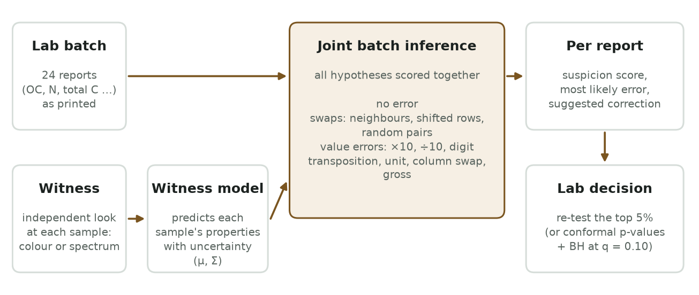
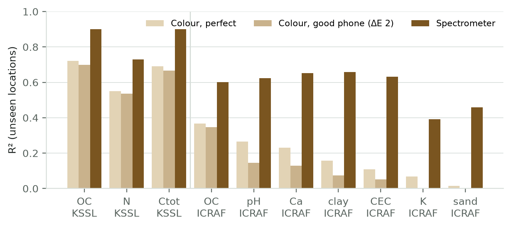
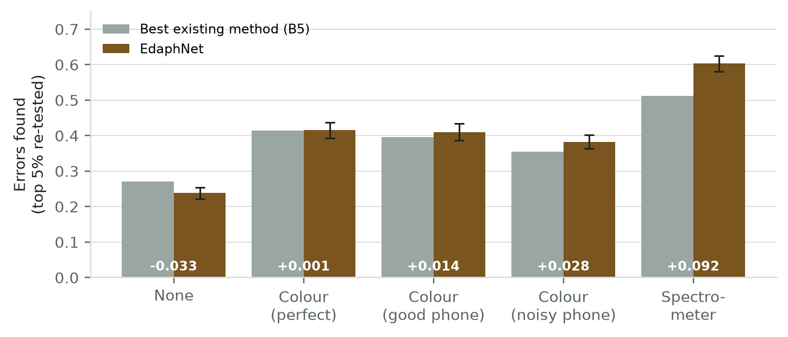
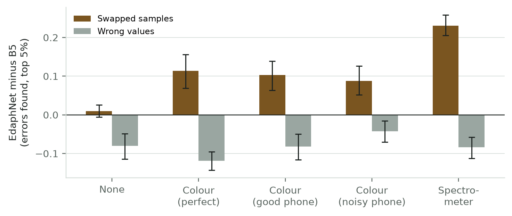
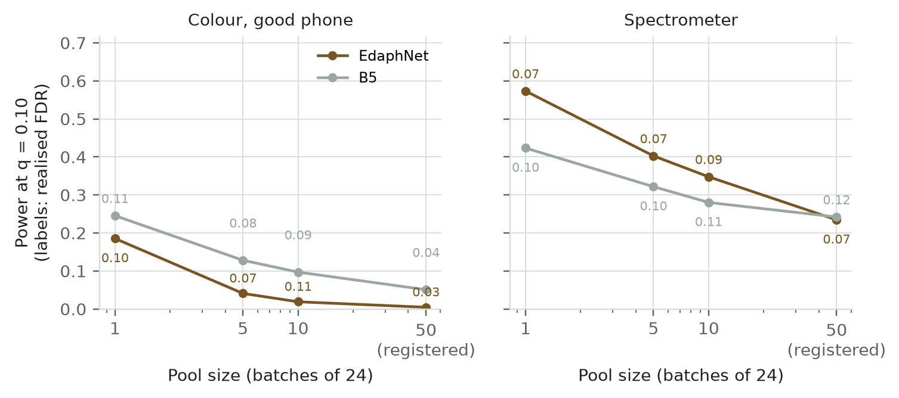
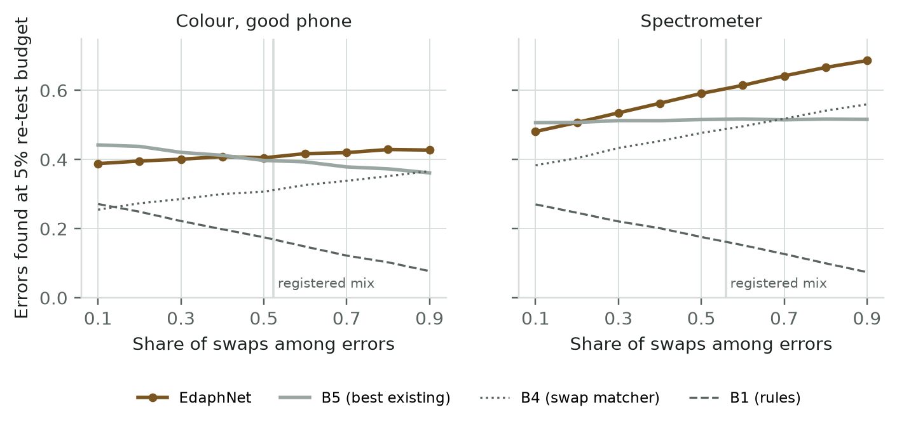

# DRAFT v0 — not for circulation

<!--
Status (2026-10-02): all sections drafted. Results follow docs 13, 14, 17, 21 and 23; exploratory
results are labelled as such. Every number in the text must trace to a run record in
results/runs/. Citations marked [verify] must be checked against the full text before submission.
The formal Scopus/WoS search (docs/search_log.csv) has not been run yet, so Related Work is
provisional.
v0.2 (2026-10-03, after an external review; doc 26, D-025): abstract corrected (exploratory
results marked, calibration statement fixed, B5's power advantage stated); method diagram (Fig. 1);
gross-error diagnosis (§7.5); five-seed unknown-error run (§7.6); attribution as a main result
(§7.8); error-mix sensitivity (§7.9, Fig. 6); Fig. 5 labels fixed. Figures renumbered (files keep
their names).
-->

**Title:** When is a cheap witness enough? Detecting sample swaps and value errors in soil
laboratory reports with an independent observation of the sample

*(The A1-pass title is retired: the pre-registered primary claim failed, §7.4.)*

---

## Abstract

Soil test reports can be wrong in two ways that matter to the farmer: a report can belong to a
different sample (a swap), or a single value can be corrupted (a decimal slip, a unit mix-up,
transposed digits). We ask whether a cheap, independent observation of the same sample, its colour
as a phone camera could record it, can tell a laboratory which reports to re-test and what went
wrong. We propose a joint batch-level model that scores every report in a laboratory batch under
structured swap hypotheses and a library of typed value corruptions, and we evaluate it on 23,219
real soils from two open spectral libraries with injected errors, using a witness ladder from no
witness to a laboratory spectrometer. In a pre-registered test on 19,746 KSSL samples, re-testing
the top 5% of reports, the method did not find more errors than the best existing approach when
the witness was soil colour (+0.001 and +0.014; confidence intervals include zero), but did with a
spectrometer (+0.092 [0.069, 0.113]). Where attribution could be evaluated (spectrometer), the
method named the correct error type in 97–100% of flagged value errors, against 24–29% for
rule-based repair (pre-registered). Exploratory analyses, not pre-registered, show why colour did
not win overall: it found 10 points more swapped samples (+0.103 [0.064, 0.139]) and 8 points fewer
wrong values than a supervised baseline, and the two effects cancelled at the injected, roughly equal
mix. Re-scored under other mixes, the method beat that baseline once 60–70% of errors were swaps
with colour, and 30% with a spectrometer. We also show that conformal false-discovery-rate control
for report verification fails silently when calibration samples are reused, and that its power
depends on the number of distinct calibration reports relative to the number of reports tested at
once; with colour, the supervised baseline kept more power at every pool size. A cheap colour
witness is enough to catch swaps, not wrong values; the real error mix decides whether it pays off.

---

## 1. Introduction

Soil test reports drive fertiliser recommendations, liming decisions and, increasingly, carbon
accounting. A report can be wrong without anyone noticing. Samples can be mislabelled or placed in
the wrong tray position, so a farmer receives the results of a different sample. Single values can
be corrupted by decimal slips, unit confusion, transposed digits, interchanged columns or
analytical failures. Inter-laboratory studies show that measurement disagreement is not rare: in
one recent comparison of eight service laboratories, 28% of soil organic carbon observations fell
outside the acceptable range of the North American Proficiency Testing programme [SOIL 2025].
Laboratory quality control (reference samples, proficiency testing, rule-based plausibility
checks) operates at the level of the laboratory. The individual farmer receiving an individual
report has no independent way to tell whether that report is plausible for *their* sample.

This paper asks whether a cheap, independent observation of the same physical sample (a
"witness", here the soil's colour as a phone camera could record it) can help decide **which
reports a laboratory should re-test**, and **what went wrong** with them. The witness cannot be
corrupted by the laboratory's data handling. It can therefore reveal errors that look internally
consistent, in particular sample swaps, where a report is a perfectly plausible report of a
*different* soil.

We make the following contributions:

1. **A joint batch-level error model** that scores every report in a laboratory batch under
   structured swap hypotheses (adjacent transpositions, tray-shift rotations, pair swaps) and a
   library of typed value corruptions, using a calibrated witness model. It returns, for each
   report, an error score, the most likely explanation (swap partner or corruption type) and a
   proposed correction. Its clearest advantage is explanation: it names the correct error type far
   more often than rule-based repair (§7.8). With a colour witness it finds swapped samples better
   than all baselines, but not single wrong values (§7.4–7.5), so whether it pays off depends on the
   error mix (§7.9).
2. **A detectability analysis** across a ladder of witness strengths (none, colour with
   phone-like noise, coarse visible bands, full Vis-NIR spectrum), showing which error types a
   witness makes detectable and which it does not.
3. **A methodological finding on calibrated error control**: conformal false-discovery-rate
   control for report verification fails silently when calibration samples are reused across
   batches (pseudo-replication), and loses power when the number of distinct calibration reports
   is small relative to the number of reports tested at once.
4. **Pre-registered, reproducible evaluation** on open soil spectral libraries, including the
   negative results: the original claim (phone-grade witness at controlled FDR) did not pass.

## 2. Related work

**Soil properties from images.** Smartphone and digital-camera images have been used to estimate
soil organic matter or carbon, texture, iron oxides and electrical conductivity, usually from
colour features or convolutional networks [refs 1–7 in doc 09]. Munsell colour from phones with an
in-frame reference is available in deployed tools (LandPKS). A recent open dataset evaluates
smartphone imaging for SOC across four devices on 84 samples [Zenodo 10.5281/zenodo.22876123, 2026;
verify]. Reported limitations are device dependence, illumination and generalisation beyond
controlled capture. These works *predict*
properties; they do not verify laboratory reports.

**Validating laboratory values against predictions.** Checking a laboratory value against a
value predicted from other measurements is established in process industries (US 8,352,394) and
in clinical laboratories through autoverification and delta checks. Multi-analyte
machine-learning delta checks detect wrong-blood-in-tube errors better than univariate rules
[AJCP 2018; Clin Chem 2023]. These approaches use the patient's history or process sensors, not
an independent observation of the same specimen.

**Sample-swap detection.** In genomics, mislabelled samples are detected and corrected by matching
two data types from the same individual (Broman et al. 2014; Crosscheck). These rely on
near-deterministic genetic witnesses. Our setting has a weak, noisy witness and also includes
single-value corruptions.

**Numeric error detection and conformal outlier testing.** Regression-based label-error scores
(Zhou et al. 2023, implemented in cleanlab) and conformal p-values with Benjamini–Hochberg control
(Bates et al. 2023; Jin & Candès 2023) are general tools that we use as baselines and components.
In soil spectroscopy, uncertainty-guided rejection sends unreliable *predictions* back to the
laboratory (Schmidinger et al. 2026), the reverse direction of our problem.

**Gap.** We found no work that uses an independent observation of the same soil sample to jointly
detect, attribute and correct swaps and value errors across a laboratory batch, or that
characterises which errors such a witness can make detectable. [To be confirmed by the formal
search.]

## 3. Problem statement

A batch contains n reports. Report j is recorded as sample j, but may have been measured on sample
π(j) (a swap), and any of its values may be corrupted by an operator from a library 𝒞. For every
sample we observe a witness wᵢ. Given the batch, the tasks are: (a) rank reports for re-testing
under a budget, (b) attribute each flagged error (swap partner, or corrupted property and
operator), (c) propose a correction, and (d) characterise detectability as a function of witness
strength. Calibrated error control (flagging at a target FDR) is studied as a secondary task.

## 4. Method

**Figure 1.** Method overview. The witness model turns each sample's independent observation into a
predicted property distribution; the batch of printed reports is scored jointly under swap and
value-error hypotheses; each report receives a suspicion score, an explanation and a correction.

**Witness model.** Properties are mapped to a standardised latent scale (identity, log or logit
per property), and p(z | w) is modelled as Gaussian with mean μ(w) (gradient-boosted regression
per property) and full residual covariance Σ (out-of-fold residuals). This makes the model
joint across properties, so one corrupted value can be detected through its inconsistency with
the other values even when the witness is uninformative for that property.

**Value-corruption library.** ×10, ÷10; unit confusions for the properties present; adjacent-digit
transposition of the printed value; interchange of two columns; and a gross multiplicative error
integrated over a fixed grid. Priors are equal per group and uniform within a group. At most one
corrupted cell per report.

**Structured swap hypotheses.** Identity; adjacent transpositions; cyclic rotations by ±1 (blocks
of length ≥ 3) and ±2 (length ≥ 5), modelling tray shifts; and arbitrary pair transpositions.

**Joint inference.** For report j and candidate sample i,
ℓ(j, i) = log Σ_c P(c) p(T_c⁻¹(r_j) | w_i) |J_c|. The posterior of each swap hypothesis is
log P(π) + Σ_moved [ℓ(j, π(j)) − ℓ(j, j)], normalised over the enumerated set. Inference is exact
over the hypothesis set. Per report: P(clean) = (1 − P(moved)) · P(c = none | r_j, w_j); the error
score is 1 − P(clean); the explanation is the MAP swap partner or the MAP corruption.

**Re-test policy and error control.** Reports are ranked by error score, and the top fraction
(budget) is re-tested. For error control, conformal p-values against clean calibration reports,
with Benjamini–Hochberg per pool of batches. Calibration uses **one score per distinct
calibration sample** (§6.4).

## 5. Data

**Synthetic (T0).** Gaussian-copula soil properties (8 properties) with a 3-dimensional
colour-like witness of controllable strength λ, used to test the mechanism.

**Real data.** Open Soil Spectral Library v1.2, open-licence subsets only (LUCAS excluded pending
licence). ICRAF-ISRIC: 3,473 samples, 553 profiles, pH, OC, clay, sand, CEC, K, Ca, Mg.
KSSL Vis-NIR: 19,746 samples, 6,999 locations, OC, N, total C. Splits are disjoint by profile or
location (train 50%, calibration 15%, test 35%).

**Witness ladder.** From each sample's laboratory Vis-NIR spectrum: CIELAB colour (D65, 2°) with
added isotropic noise of mean magnitude ΔE ∈ {0, 2, 4, 8}, a phone-capture proxy; 10 visible
bands; the full spectrum (PCA of log 1/R). Colour from laboratory spectra is a best-case proxy for
a phone photograph (§8).

**Errors.** Injected: a swap event in 20% of batches (adjacent, tray-shift or pair swap with equal
probability), value corruptions in 2.5% of other reports, about 5% erroneous reports in total.

## 6. Experimental protocol

6.1 **Baselines:** range checks (B0), soil-science consistency rules (B1), a lab-only multivariate
density (B2), a per-value witness interval check (B3), swap-only assignment matching (B4), a
supervised classifier trained on injected errors (B5), cleanlab regression label-quality (B7),
and rule-based unit/decimal repair for attribution (B6).

6.2 **Metrics:** recall at a 5% re-test budget (primary, amendment v2); attribution accuracy;
detectability by error type; realised FDR at q = 0.10 (secondary); AUPRC.

6.3 **Pre-registration:** the v1 specification (doc 11), and amendment v2 with Amendment 1
(doc 18), were committed before the corresponding evaluations. Pass/fail rules and the analysis
script were fixed in advance.

6.4 **Calibration without pseudo-replication:** each distinct calibration sample contributes one
score. A diagnostic on the step-5 calibration split showed that counting reused samples
inflates realised FDR (e.g. 0.57 → 0.00 for range checks once de-duplicated).

6.5 **Settings:** batch size 24; pools of 50 batches; 5 seeds (amendment v2); random and
clustered (same profile/location) batch orderings.

## 7. Results

Unless stated otherwise, the metric is the share of erroneous reports found when the top 5% of
reports per pool of 50 batches are re-tested (recall at budget). Intervals are 95% cluster-bootstrap
intervals over pools. **Exploratory** results were not pre-registered and are marked as such.

### 7.1 Simulation: the mechanism works with a moderately informative witness

On synthetic soils with a witness of controllable strength (doc 13), the joint model beat every
baseline only when the witness was moderately informative. With colour explaining ~66% of organic
carbon (λ = 2, random batches), it caught 0.65 of errors at FDR 0.10 against 0.42 for the best
baseline; with a weak witness (λ ≤ 0.5) the gain was ≤ 0.01. The gain came almost entirely from
swap detection; the swap partner was correct in 87–91% of flagged swaps at λ = 2. The prediction
that a weak witness would give the largest gain (H2) was refuted.

### 7.2 What a colour witness knows about real soils

**Figure 2.** R² of each property from each witness on unseen locations.

Colour computed from laboratory spectra explains organic carbon well on KSSL (R² 0.72; 0.70 with
phone-like noise ΔE 2) and moderately on ICRAF-ISRIC (0.37; 0.35), nitrogen and total carbon on KSSL
(0.55, 0.69), and little else on ICRAF (pH 0.27, Ca 0.23, clay 0.16, CEC 0.11, K 0.07, sand 0.02).
A spectrometer explains 0.39–0.90 of all properties. A colour witness therefore sits at the low
end of the range where the simulation showed a benefit, except for carbon on KSSL.

### 7.3 First real-data test (ICRAF-ISRIC): failed, with a flawed calibration procedure

The original primary test (power at FDR 0.10 with a phone-grade colour witness; doc 17) did not pass:
+0.03 and +0.05 in random batches, −0.05 and −0.01 in clustered batches. Realised FDR of most
baselines was 0.4–0.9. A later diagnostic on the calibration split only (§7.7) showed that this was
mainly caused by our calibration design (reusing ~511 calibration samples across 400 batches), so
the comparison was not valid in either direction. The verdict is reported as recorded.

### 7.4 Pre-registered test on new data (KSSL): primary claim not supported

**Figure 3.** Pre-registered KSSL test, random batches, 5 seeds. Numbers: EdaphNet minus the best
existing method (B5 in every cell); whiskers: 95% interval of the difference.

| Witness | EdaphNet | Best baseline | Difference [95% CI] |
|---|---|---|---|
| None | 0.238 | 0.271 | −0.033 [−0.049, −0.016] |
| Colour, perfect | 0.416 | 0.415 | +0.001 [−0.022, 0.023] |
| Colour, good phone (ΔE 2) | 0.410 | 0.396 | +0.014 [−0.008, 0.038] |
| Colour, noisy phone (ΔE 4) | 0.382 | 0.354 | +0.028 [0.010, 0.049] |
| Spectrometer | 0.604 | 0.512 | +0.092 [0.069, 0.113] |

The primary hypothesis A1 (≥ +0.05 with CI > 0 at both colour settings) **failed**. Non-inferiority
in clustered batches (A1-c) passed (+0.013, +0.010). Error control with shift-aware calibration (A2)
kept realised FDR ≤ 0.09 for every method, but with a colour witness EdaphNet flagged almost nothing
at the registered pool size (§7.7). Attribution (A3) passed where it could be evaluated (§7.8).

### 7.5 Swaps versus wrong values (exploratory)

**Figure 4.** EdaphNet minus B5 for swapped samples and for wrong values, random batches.

The near-zero overall difference hides two effects of opposite sign. With a good-phone colour
witness, EdaphNet found **+0.103 [0.064, 0.139]** more swapped reports and **−0.082 [−0.116, −0.050]**
fewer wrong values than B5; with a spectrometer, +0.231 [0.205, 0.258] and −0.084 [−0.112, −0.058].
Clustered batches showed the same pattern. Wrong values were lost mainly on gross analytical errors
(0.03 vs 0.26 found) and ×10 slips (0.68 vs 0.80).

A diagnosis of the gross errors (good-phone colour, random batches, 208 gross errors) found no
scoring artefact. EdaphNet did rank them above most reports (median at the 75th percentile of their
pool), but rarely inside the top 5%, which swaps and ×10 slips with near-certain posteriors
filled first, and it usually explained them as a digit transposition or a column interchange rather
than a gross error. The baselines that caught them exploit the hard constraint that organic carbon
cannot exceed total carbon (B1 explicitly, B5 through training on the injected mix): gross errors on
organic carbon were found by B5 and B1 in 43% and 34% of cases, against 10% for EdaphNet, and gross
errors on nitrogen, which break no such constraint, were hard for every method (≤ 10%). EdaphNet's
Gaussian witness model captures the correlation between the carbon properties but not this
inequality. Identical gross-error recall for several EdaphNet variants (0.034) reflects small counts
(7 of 208), not tied scores. Ablations (good-phone colour) show that the swap
hypotheses and the witness create the swap advantage (+0.39 and +0.40 on swaps) and cost value
errors under a fixed budget (−0.07, −0.04). The corruption library trades swap sensitivity (−0.070
[−0.091, −0.050]) for slightly better value-error detection (+0.023 [0.010, 0.037]). The
structured swap prior had no effect (H6 not supported).

### 7.6 Errors outside the library (exploratory, five seeds)

With value errors drawn only from four types the method does not model (×100, ×4–8 gross, a value
copied from the neighbouring report, a dropped digit), the pattern held over five seeds: swaps
+0.103 [0.069, 0.137] and wrong values −0.057 [−0.078, −0.036] versus B5 (good-phone colour, random
batches), with an overall difference of +0.027 [0.009, 0.047]; clustered batches gave +0.105
[0.062, 0.147] and −0.078 [−0.105, −0.050]. With a spectrometer: swaps +0.147 [0.118, 0.176], wrong
values −0.032 [−0.056, −0.009]. Large unknown errors were found by all methods (×100: 99% vs 91%);
subtle ones were hard for all (dropped digit 14% vs 16%, neighbour copy 42% vs 49%), and gross ×4–8
errors again favoured B5 (40% vs 61%). B5 was trained on the same unknown error mix, which favours it.
A first single-seed run gave the same pattern with intervals two to three times wider; its seed was
reproduced exactly within the five-seed run.

### 7.7 Calibrated error control needs many distinct verified reports

On the step-5 calibration split, keeping one score per distinct calibration sample reduced the
realised FDR of range checks from 0.57 to 0.00 and of the lab-only model from 0.63 to 0.07
(exchangeable halves), confirming pseudo-replication as the cause of §7.3's failure. With only ~260
distinct calibration samples, power fell to ≈ 0. On KSSL (~2,800 distinct samples) FDR was
controlled, but with a colour witness EdaphNet's power at the registered pool of 50 batches was
≈ 0.

The reason is partly mechanical. A conformal p-value cannot be smaller than 1/(N + 1) for N
calibration reports, and Benjamini–Hochberg over m reports at level q can reject only when at least
m / (q(N + 1)) reports reach that floor: about 5 reports for the registered pool (m = 1,200,
N ≈ 2,800), but fewer than one for a single batch (m = 24). EdaphNet concentrates its evidence in a
few reports per batch, so it is hit hardest. Re-testing the stored p-values per single batch
(exploratory) restored its power to 0.19–0.25 at realised FDR ≈ 0.10 (Figure 5). With a colour
witness, B5 kept more power than EdaphNet at every pool size (e.g. 0.25 vs 0.19 per batch), but its
realised FDR rose to 0.16–0.17 in some clustered settings; with a spectrometer, EdaphNet had more
power at every pool size except the largest.

**Figure 5.** Power at q = 0.10 against pool size (stored conformal p-values; labels: realised FDR).

### 7.8 Explaining errors: the clearest advantage of the joint model

Among flagged value errors, EdaphNet named the correct corruption in 97–100% (KSSL, spectrometer;
pre-registered as A3), 89–98% (ICRAF) and 84–92% (simulation), against 24–29%, 37–51% and 32–50%
for rule-based unit/decimal repair. Among flagged swaps, it named the correct partner in 87–99% with
a spectrometer witness (ICRAF-ISRIC). Among the baselines, only rule-based repair (B6) states what
went wrong with a value; the swap matcher B4 implies a reassignment of reports but cannot explain
value errors, and B5 and cleanlab only score reports. This is the main practical reason for a joint model even where its detection rate is close
to a simpler method's: a laboratory re-testing a report also learns what to look for (the swap
partner, or which value and which slip). On KSSL, attribution could be evaluated only with a
spectrometer: with a colour witness, fewer than the pre-registered minimum of 30 value errors were
flagged per cell.

### 7.9 Who wins depends on the error mix (exploratory)

**Figure 6.** Errors found at a 5% re-test budget as the share of swaps among errors varies (random
batches; stored scores re-ranked after resampling each pool; vertical line: injected mix).

The registered test injected swaps and value errors in roughly equal numbers (52–56% swaps), and
§7.5 showed that the comparison with B5 turns on this mix. We re-ranked the stored scores of the
registered run after resampling each pool to swap shares from 10% to 90%, keeping the number of
errors per pool, the error prevalence and the 5% budget fixed (20 resamples per pool; 95% cluster
bootstrap over pools). Scores were not recomputed, so this is an approximation.
With a good-phone colour witness (random batches), EdaphNet minus B5 rose from −0.054 [−0.081,
−0.027] at 10% swaps to +0.008 [−0.013, 0.029] at 50%, +0.024 [0.001, 0.048] at 60% and +0.066
[0.037, 0.095] at 90%; in clustered batches the difference became significant from 70% swaps. With a
spectrometer it was −0.026 [−0.046, −0.006] at 10%, +0.022 [0.005, 0.040] at 30% and +0.170 [0.146,
0.196] at 90%. EdaphNet found more errors than the swap-only matcher B4 at every mix (colour: +0.06 to
+0.13; spectrometer: +0.10 to +0.13), and the rule-based checks B1 declined steeply as swaps
replaced value errors. A laboratory that knows its own error mix can therefore read off which
checker to use.

## 8. Discussion and limitations

**A cheap witness is enough for swaps, not for wrong values.** Across simulation, two real
libraries and unknown error types, an independent observation of the sample consistently made
swapped samples detectable, which no lab-only check can do, because a swapped report is a plausible
report of another soil. It did not help with single wrong values, where a supervised checker trained
on the right error mix was better. Whether the method pays off overall therefore depends on the real
mix of swaps and wrong values in laboratory practice (§7.9: roughly 60–70% swaps with colour, 30%
with a spectrometer), which is not known and which our planned blind-duplicate study (doc 15) is
designed to measure.

**Why a joint model.** Its detection advantage over the swap-only matcher is moderate, and two of
its components did not help (the structured swap prior; the corruption library cost swap
sensitivity). Its distinctive contribution is explanation: it tells the laboratory which report a
sample was swapped with, or which value was corrupted and how (§7.8). Its weakness is gross
analytical errors, where hard constraints between properties (organic carbon ≤ total carbon) carry
information that the Gaussian witness model does not use (§7.5); adding such constraints is a
direct extension.

**Practical use.** The results suggest a combined policy: the joint model for swaps and attribution,
a dedicated checker for single values, and error control per batch rather than across many
batches. This is a hypothesis to be registered and tested on new data (doc 20), not a result.

**Limitations.**
1. Errors were injected, not observed; the error mix (about 50% swaps) is an assumption, and §7.9
   shows how the comparison changes with it (approximately, by re-ranking stored scores).
2. The colour witness was computed from laboratory spectra of dried, sieved samples, a best-case
   proxy for a phone photograph; real photos add noise but also texture.
3. KSSL properties are all carbon-related, which favours colour; ICRAF covers more properties but
   fewer samples.
4. B5 was trained on the true injected error mix, an advantage it would not have in practice.
5. Clustered batches were built from depth layers of one profile, which is harsher than typical
   laboratory trays.
6. Exploratory results (§7.5–7.7, §7.9) were not pre-registered; the pool-size observation was made after
   seeing the data.
7. No Indian soils are included yet; transfer is untested.

## 9. Conclusion

An independent observation of a soil sample, even only its colour, makes sample swaps in laboratory
reports detectable and lets a batch-level model explain errors correctly, but a colour witness does
not make single wrong values easier to find, and with an equal mix of both it did not beat the best
existing approach in a pre-registered test. With a spectrometer it did. With colour, it pays off
when most errors are swaps. Reliable automated alarms need a calibration set that is large relative
to the number of reports tested at once, or testing one batch at a time. The next steps are real
phone photographs and real error rates from soil-testing laboratories, and a registered test of a
combined re-test policy.

## Reproducibility statement

Code, configurations, seeds, split files and run records are in the repository. Every number
traces to a run folder. `HOW_TO_RUN.md` reproduces all experiments; `REPRODUCE.md` lists the exact
commands from data download to every table and figure. Exploratory analyses are separate scripts
(`exploratory_tables.py`, `rescore_pools.py`, `diag_gross.py`, `error_mix.py`) that read the stored
predictions and write to `results/exploratory/`. AI-assistance statement: [to be agreed with the
supervisor before submission; code and drafts were developed with an AI assistant].
